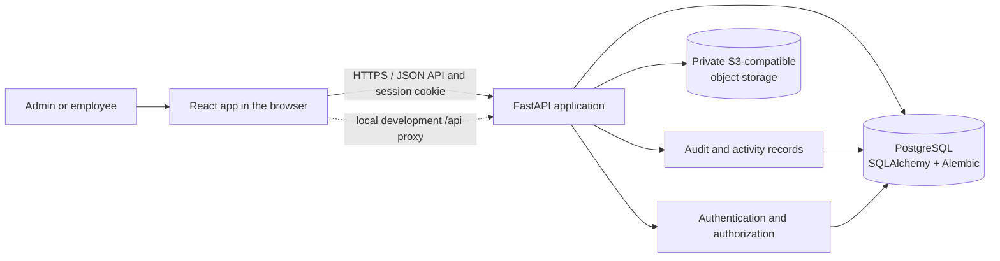
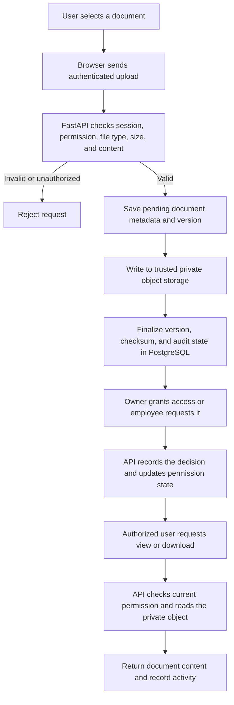

# SureDocs

SureDocs is a secure document-management workspace for organizations. Employees can upload, organize, and access documents according to explicit permissions; administrators can manage users, access controls, security scans, and audit activity.

## Demo accounts

Use these credentials only for the provisioned SureDocs demo environment. Do not reuse these passwords for personal or production accounts.

| Role | Login ID | Password |
| --- | --- | --- |
| Demo Admin | `admin@suredocs.test` | `SdTest-pO%LBVMdbZzpaS8VR01V!n` |
| Demo Employee | `sanjay.kumar.0021@suredocs.test` | `SdTest-QYVuH%RlcoaPwy@5OMw@jy` |

Live website link  : https://suredocs-one.vercel.app/

The local seeding command below creates separate local-only demo accounts and generates their passwords in ignored files under `secrets/`; those accounts are distinct from the demo accounts listed above.

## Technology stack

<p>
  <a href="https://react.dev/"></a>
  <a href="https://vite.dev/"></a>
  <a href="https://www.python.org/"></a>
  <a href="https://fastapi.tiangolo.com/"></a>
  <a href="https://www.postgresql.org/"></a>
  <a href="https://www.docker.com/"></a>
  <a href="https://aws.amazon.com/s3/"></a>
</p>

| Area | Technology |
| --- | --- |
| Web application | React 19, Vite 8, Tailwind CSS |
| API | Python, FastAPI, Pydantic |
| Persistence | PostgreSQL, SQLAlchemy, Alembic |
| Document storage | Private S3-compatible object storage (AWS SDK / Boto3) |
| Local services | Docker Compose |

## What the application does

- Provides role-aware admin and employee workspaces.
- Supports document upload, metadata, versions, previews, and access-controlled downloads.
- Lets document owners grant, change, expire, or revoke view, download, and edit permissions.
- Supports employee access requests and owner decisions.
- Records document and authentication activity for audit and security monitoring.

## Application workflow

1. A user signs in. The API verifies the account and creates an HTTP-only session cookie.
2. The employee workspace lets the user find documents, upload a new document, or request access to another owner's document.
3. The API validates the file format, size, checksum, and metadata, writes the file to private S3, and finalizes the version and audit state in PostgreSQL.
4. Owners manage grants directly or review access requests. Each document read or download is authorized against the current grant and recorded as appropriate.
5. Administrators manage accounts, review audit activity, and monitor security events.

### Architecture diagram



### Document upload and access data flow



## Local setup (Windows PowerShell)

### Prerequisites

- Git
- Node.js 20.19+ or 22.12+
- Python 3.11+
- Docker Desktop with Docker Compose
- An S3-compatible bucket and credentials for actual document uploads

From the repository root, create local-only secrets and copy the environment template:

```powershell
New-Item -ItemType Directory -Force .\secrets | Out-Null
@('postgres_password.txt', 'pgadmin_password.txt', 'suredocs_app_password.txt') |
  ForEach-Object {
    $path = Join-Path .\secrets $_
    if (-not (Test-Path $path)) {
      $secret = python -c "import secrets; print(secrets.token_urlsafe(32))"
      Set-Content -NoNewline -Encoding ascii -Path $path -Value $secret
    }
  }
Copy-Item .\.env.example .\.env
```

Start PostgreSQL:

```powershell
docker compose up -d db
docker compose ps
```

For a new local database, create the application role using the generated password file. This runs SQL inside the database container; it does not print the password:

```powershell
$appPassword = (Get-Content .\secrets\suredocs_app_password.txt -Raw).Trim()
$sql = @"
CREATE ROLE suredocs_app LOGIN PASSWORD '$appPassword';
ALTER DATABASE suredocs OWNER TO suredocs_app;
"@
$sql | docker compose exec -T db psql -U suredocs_admin -d suredocs
```

Install Python dependencies, apply migrations, and optionally create local demo users:

```powershell
Set-Location .\backend
py -3.11 -m venv .venv
.\.venv\Scripts\Activate.ps1
python -m pip install --upgrade pip
pip install -r requirements.txt
alembic upgrade head
python -m app.cli seed-demo-users --confirm-development
```

If PowerShell blocks virtual-environment activation, run `Set-ExecutionPolicy -Scope Process -ExecutionPolicy Bypass` in that terminal and activate again. The local demo-user command only runs against the explicitly identified local development database. It creates `admin.demo@example.com` and `employee.demo@example.com`; their generated passwords are kept in `secrets/demo_admin_password.txt` and `secrets/demo_employee_password.txt`. Those accounts are separate from the demo IDs listed above.

Before uploading documents, configure credentials for the S3-compatible bucket through the standard AWS credential chain (for example, `aws configure`) or environment variables. The backend reads `SUREDOCS_S3_BUCKET` and `SUREDOCS_AWS_REGION` from `.env`; for a custom S3-compatible endpoint, also set `AWS_ENDPOINT_URL_S3`. Do not put storage credentials in source control.

Start the API in the activated backend terminal:

```powershell
uvicorn app.main:app --reload --port 8000
```

In a second terminal at the repository root, install and start the frontend:

```powershell
npm ci
npm run dev
```

Open [http://localhost:5173](http://localhost:5173). The local Vite setup proxies API requests to `http://127.0.0.1:8000`. FastAPI's interactive API reference is available at [http://127.0.0.1:8000/api/docs](http://127.0.0.1:8000/api/docs).

## Configuration and deployment notes

- `.env.example` documents the local backend settings. The app database password is read from `secrets/suredocs_app_password.txt` unless `DB_PASSWORD` is set.
- `.env`, `.env.local`, and `secrets/` are local-only. Never commit environment files, credentials, or generated demo passwords.
- For Neon, pull the PostgreSQL and Object Storage settings into the ignored `.env.local` file with `neon env pull --file .env.local --service postgres --service object-storage`. The backend uses `DATABASE_URL` for application traffic and `DATABASE_URL_UNPOOLED` for Alembic migrations. Migrations create/update the schema; they do not migrate users, documents, audit events, or stored objects.
- For cross-site production frontends, set the backend's exact `SUREDOCS_CORS_ORIGINS`, a stable `SESSION_SECRET`, `SUREDOCS_SECURE_COOKIES=true`, and `SUREDOCS_COOKIE_SAMESITE=none`. Keep database and object-storage credentials in backend deployment settings only.
- Production document uploads require `SUREDOCS_S3_BUCKET` to name the existing private bucket; the development-bucket fallback is intentionally unavailable in production. Uploaded bytes are verified in memory and written to `documents/<document-id>/versions/<version-id>/content` with integrity checks against the SHA-256 digest.
- The runtime identity needs `s3:PutObject` for writes, `s3:GetObject` (and `s3:GetObjectVersion` for versioned objects) for `HeadObject`, and `s3:DeleteObject` (and `s3:DeleteObjectVersion` for versioned objects) for failed-verification cleanup. Scope object permissions to the existing private bucket's `documents/*` ARN and check the identity and bucket policies for explicit denies. No AWS policy is included or changed by this repository.
- The optional bulk import tool is not run at startup. Preview before importing with `python scripts/bulk_import_documents.py --owner-email admin@example.com --dry-run`; see the script's `--help` output for the manifest and documents-root options.

## Checks

From the repository root:

```powershell
npm run lint
npm run build
```

From `backend/` with the virtual environment active:

```powershell
pytest
```
