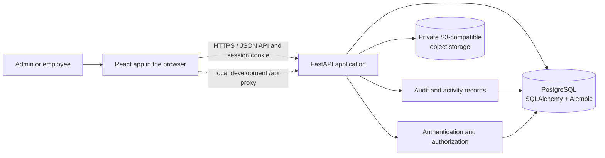
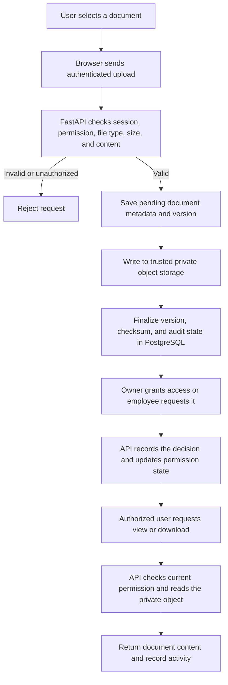
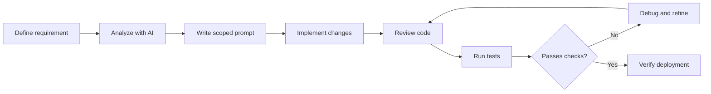

# SureDocs

SureDocs is a secure document-management workspace for organizations. Employees can upload, organize, and access documents according to explicit permissions; administrators can manage users, access controls, security scans, and audit activity.

## Demo accounts

Use these credentials only for the provisioned SureDocs demo environment. Do not reuse these passwords for personal or production accounts.

| Role | Login ID | Password |
| --- | --- | --- |
| Demo Admin | `admin@suredocs.test` | `SdTest-pO%LBVMdbZzpaS8VR01V!n` |
| Demo Employee | `sanjay.kumar.0021@suredocs.test` | `SdTest-QYVuH%RlcoaPwy@5OMw@jy` |

Live website link  : https://suredocs-one.vercel.app/

The local seeding command below creates separate local-only demo accounts and generates their passwords in ignored files under `secrets/`; those accounts are distinct from the demo accounts listed above.

## Technology stack

<p>
  <a href="https://react.dev/"></a>
  <a href="https://vite.dev/"></a>
  <a href="https://www.python.org/"></a>
  <a href="https://fastapi.tiangolo.com/"></a>
  <a href="https://www.postgresql.org/"></a>
  <a href="https://www.docker.com/"></a>
  <a href="https://aws.amazon.com/s3/"></a>
</p>

| Area | Technology |
| --- | --- |
| Web application | React 19, Vite 8, Tailwind CSS |
| API | Python, FastAPI, Pydantic |
| Persistence | PostgreSQL, SQLAlchemy, Alembic |
| Document storage | Private S3-compatible object storage (AWS SDK / Boto3) |
| Local services | Docker Compose |

## What the application does

- Provides role-aware admin and employee workspaces.
- Supports document upload, metadata, versions, previews, and access-controlled downloads.
- Lets document owners grant, change, expire, or revoke view, download, and edit permissions.
- Supports employee access requests and owner decisions.
- Records document and authentication activity for audit and security monitoring.

## Application workflow

1. A user signs in. The API verifies the account and creates an HTTP-only session cookie.
2. The employee workspace lets the user find documents, upload a new document, or request access to another owner's document.
3. The API validates the file format, size, checksum, and metadata, writes the file to private S3, and finalizes the version and audit state in PostgreSQL.
4. Owners manage grants directly or review access requests. Each document read or download is authorized against the current grant and recorded as appropriate.
5. Administrators manage accounts, review audit activity, and monitor security events.

### Architecture diagram



### Document upload and access data flow



# SureDocs — Local Setup Guide
This guide explains how to run SureDocs locally for development. Adjust paths and environment variable names to match the current repository configuration.

## 1. Prerequisites
Install the following:

- Git
- Python 3.11+ (use the version required by `backend/requirements.txt` or project configuration)
- Node.js LTS and npm
- Docker Desktop (for local PostgreSQL, if using the provided Docker setup)
- AWS account and access to the SureDocs S3 bucket, if testing real document storage
Check your installations:

```
git --version
python --version
node --version
npm --version
docker --version
docker compose version
```

## 2. Clone the repository
Replace `<YOUR_GITHUB_REPOSITORY_URL>` with your repository URL.

```
git clone <YOUR_GITHUB_REPOSITORY_URL>
cd SureDocs
```
If the cloned folder has a different name, `cd` into that folder instead.

## 3. Configure environment variables
Do not commit `.env` files, passwords, session secrets, or AWS credentials to Git.

Inspect the repository for `.env.example`, backend configuration, and frontend configuration before creating local environment files. Copy the example files if they exist:

```
Copy-Item backend/.env.example backend/.env
Copy-Item frontend/.env.example frontend/.env
```
If those example files do not exist, create the required files based on the variables read by the current application. The paths above are examples and may differ in your repository.

Typical backend settings may include:

```
DATABASE_URL=postgresql://<DB_USER>:<DB_PASSWORD>@localhost:5432/<DB_NAME>
SESSION_SECRET=<GENERATE_A_RANDOM_SECRET_AT_LEAST_32_CHARACTERS>
S3_BUCKET_NAME=<YOUR_PRIVATE_S3_BUCKET>
AWS_REGION=<YOUR_AWS_REGION>
```
Your application may use different variable names. Confirm the exact names in the backend configuration before starting the server. Configure AWS credentials using a supported local AWS profile or environment variables; never paste credentials into source code. Ensure the S3 bucket remains private and access is enforced by the backend.

For a frontend built with Vite, the API URL is often configured using a `VITE_`-prefixed variable, for example:

```
VITE_API_BASE_URL=http://127.0.0.1:8000
```
Use the variable name and API URL expected by your frontend. Do not assume this example matches your repository.

## 4. Start PostgreSQL with Docker Compose
First, check whether the repository already has a `docker-compose.yml` or `compose.yaml` file configured for PostgreSQL. From the directory containing that file, run:

```
docker compose up -d
docker compose ps
```
If the Compose file is in another directory, pass its path explicitly, for example:

```
docker compose -f .\backend\compose.yaml up -d
```
The file path above is only an example. If no Compose configuration exists, create or configure PostgreSQL separately using the database name, username, password, and port expected by your backend.

## 5. Set up the backend
Open a PowerShell terminal at the repository root:

```
cd backend
python -m venv .venv
.\.venv\Scripts\Activate.ps1
python -m pip install --upgrade pip
pip install -r requirements.txt
```
If PowerShell blocks virtual-environment activation, you can run the environment's Python directly instead:

```
.\.venv\Scripts\python.exe -m pip install --upgrade pip
.\.venv\Scripts\python.exe -m pip install -r requirements.txt
```

### Apply database migrations
If the project uses Alembic, run:

```
alembic upgrade head
```
Run this from the directory where the project's Alembic configuration is available and after `DATABASE_URL` is configured. If your repository has a documented migration command or migration configuration in a different directory, follow that setup.

### Start the API server
For a FastAPI application whose entry point is `main.py` and whose app object is named `app`, the command is:

```
uvicorn main:app --reload --host 127.0.0.1 --port 8000
```
If the application entry point differs, use the module path documented by the repository. Keep this development server local; do not expose it publicly as a production server.

Open the API documentation at:

- [http://127.0.0.1:8000/docs](http://127.0.0.1:8000/docs)
- [http://127.0.0.1:8000/openapi.json](http://127.0.0.1:8000/openapi.json)
These URLs work only if the API is running on port 8000 and its documentation endpoints are enabled.

## 6. Set up the frontend
Open a **second** PowerShell terminal at the repository root. If the frontend directory is named `frontend`:

```
cd frontend
npm install
npm run
```
The final command lists scripts configured in `package.json`. Start the development server using the script available in your project, commonly:

```
npm run dev
```
If the project uses a different script, such as `start`, use the script listed by `npm run`. Open the local URL printed in the terminal, commonly [http://localhost:5173](http://localhost:5173) for Vite.

## 7. Verify the application

- Confirm PostgreSQL is running: `docker compose ps`
- Confirm the API starts without configuration or database errors.
- Open the API docs, if enabled.
- Confirm the frontend can reach the local API.
- Sign in using a locally configured test account. Do not put real passwords in this README.
- Test document upload, viewing, download, permission grants/revocation, and audit events.
- Confirm unauthorized users cannot access documents by changing IDs or calling the API directly.
- Confirm documents are stored in the private S3 bucket and are not publicly readable.

## 8. Common commands

### Stop PostgreSQL
Run from the directory containing the Compose file:

```
docker compose down
```
This normally preserves named database volumes. To remove data as well, Docker Compose has a `-v` option; **do not use it unless you intentionally want to delete the local database volume**.

### Restart the API
Stop the server with `Ctrl+C`, then run its Uvicorn command again.

### Restart the frontend
Stop the development server with `Ctrl+C`, then run the appropriate npm script again.

### Inspect container logs

```
docker compose logs --tail 100
```

### Check Git status
From the repository root:

```
git status
```

## 9. Troubleshooting
**Database connection fails**

- Verify PostgreSQL is running and its port is mapped correctly.
- Check `DATABASE_URL`, database name, username, and password.
- Confirm migrations ran successfully.
**Frontend cannot reach the API**

- Confirm the backend is running and the configured API base URL is correct.
- Check the backend CORS settings for the local frontend origin.
- Inspect browser developer tools and backend logs.
**S3 upload or download fails**

- Verify the bucket name and AWS region.
- Check local AWS credentials or profile and IAM permissions.
- Confirm the backend uses the intended AWS identity and the bucket is private.
- Check bucket policy, encryption requirements, and any configured upload-size limits.
**Python dependencies fail**

- Confirm you are using the intended Python version and activated `.venv`.
- Upgrade pip and retry installation.
- Read the full error before changing dependency versions.
**npm command fails**

- Confirm Node.js and npm are installed.
- Run `npm install` from the directory containing the frontend's `package.json`.
- Use the scripts listed by `npm run`.

## 10. Before committing
Check that secrets and local files are excluded from Git:

```
git status
```
Ensure `.env`, `backend/.env`, `frontend/.env`, `.venv/`, `node_modules/`, and local database files are ignored where applicable. Never commit real passwords, access keys, session secrets, or production data.

---
**Repository-specific note:** These commands are a practical starting point based on the SureDocs architecture described in the main README. Confirm directory names, Python version, FastAPI entry point, Compose file location, environment variable names, and npm scripts against the actual repository before running them.

## Configuration and deployment notes

- `.env.example` documents the local backend settings. The app database password is read from `secrets/suredocs_app_password.txt` unless `DB_PASSWORD` is set.
- `.env`, `.env.local`, and `secrets/` are local-only. Never commit environment files, credentials, or generated demo passwords.
- For Neon, pull the PostgreSQL and Object Storage settings into the ignored `.env.local` file with `neon env pull --file .env.local --service postgres --service object-storage`. The backend uses `DATABASE_URL` for application traffic and `DATABASE_URL_UNPOOLED` for Alembic migrations. Migrations create/update the schema; they do not migrate users, documents, audit events, or stored objects.
- For cross-site production frontends, set the backend's exact `SUREDOCS_CORS_ORIGINS`, a stable `SESSION_SECRET`, `SUREDOCS_SECURE_COOKIES=true`, and `SUREDOCS_COOKIE_SAMESITE=none`. Keep database and object-storage credentials in backend deployment settings only.
- Production document uploads require `SUREDOCS_S3_BUCKET` to name the existing private bucket; the development-bucket fallback is intentionally unavailable in production. Uploaded bytes are verified in memory and written to `documents/<document-id>/versions/<version-id>/content` with integrity checks against the SHA-256 digest.
- The runtime identity needs `s3:PutObject` for writes, `s3:GetObject` (and `s3:GetObjectVersion` for versioned objects) for `HeadObject`, and `s3:DeleteObject` (and `s3:DeleteObjectVersion` for versioned objects) for failed-verification cleanup. Scope object permissions to the existing private bucket's `documents/*` ARN and check the identity and bucket policies for explicit denies. No AWS policy is included or changed by this repository.
- The optional bulk import tool is not run at startup. Preview before importing with `python scripts/bulk_import_documents.py --owner-email admin@example.com --dry-run`; see the script's `--help` output for the manifest and documents-root options.

## Checks

From the repository root:

```powershell
npm run lint
npm run build
```

From `backend/` with the virtual environment active:

```powershell
pytest
```

<div align="center">
  

  
  
  

  <p><b>How AI tools supported the design, development, debugging, and validation of SureDocs.</b></p>
</div>

---

## 🧠 Overview
SureDocs was built with an **AI-assisted software engineering workflow**. AI tools helped turn requirements into implementation tasks, explore technical approaches, refine the UI, troubleshoot deployment problems, and prepare test scenarios. They supported development; they did not replace code review or verification.

## 🧰 AI toolkit
<p align="center">
  
  
  
  
  
  
</p>

ToolHow it supported SureDocs**ChatGPT**Broke down requirements, prepared implementation prompts, explained architecture, and helped investigate API, CORS, environment, and deployment errors.**OpenAI Codex**Supported code-focused tasks such as understanding an existing codebase, implementing scoped changes, and investigating defects.**GitHub Copilot**Provided coding assistance for routine implementation, code completion, and exploring possible fixes.**Claude / Claude Code**Supported technical reasoning and codebase-oriented work, including reviewing workflows and refining implementation tasks.**Omni Router**Helped access or route between available AI models as part of a multi-model development workflow.**Google AI Studio**Provided an environment for experimenting with prompts and Google AI models while exploring technical approaches.

> **Model note:** The exact model IDs and versions are not listed because they should be taken from actual tool history. AI tools were used for development assistance; this does **not** mean SureDocs has a runtime dependency on these models.

## 🎨 UI/UX skills
Specialized Claude skills were used or selected to help guide frontend design and task execution:

- **UI/UX Pro** — interface structure, navigation, usability, and visual consistency.
- **Impeccable** — visual polish, spacing, typography, hierarchy, and interaction details.
- **Task-Skill and related skills** — reusable instructions for breaking work into scoped tasks and applying consistent implementation constraints.
These are **skills/workflows**, not necessarily separate AI models. Their contribution depends on the skill version and how it was invoked.

## 🏗️ Where AI helped
SureDocs areaAI-assisted work**Authentication & roles**Shaped requirements for user roles, account states, and server-side permission checks.**Document workflows**Specified upload, viewing, downloading, editing, deletion, sharing, and access-request behavior.**Storage & database**Worked through the application design for private Amazon S3 files and PostgreSQL metadata.**Frontend & UX**Refined React screens, dashboards, document tables, permissions, navigation, and dialogs.**Testing & security**Prepared negative test scenarios for unauthorized access, invalid requests, and revoked permissions.**Deployment**Investigated CORS, dependencies, environment variables, API availability, and production configuration.

## 🔄 Development loop

```

```

## 🔐 Responsible AI use

- AI-generated code and recommendations were treated as **suggestions to review**, not proof of correctness.
- Protected document operations must be authorized by the **backend**, not just hidden or disabled in the frontend.
- Private S3 objects and application secrets must be protected with appropriate access controls and configuration.
- Security findings must be tested before being described as verified vulnerabilities.
- Production behavior must be checked independently; a successful local change does not guarantee a successful deployment.

## ✅ Takeaway
AI helped make the SureDocs development process more iterative: **clarify the requirement → plan the change → implement → review → test → refine → verify**. The engineering responsibility for correctness, security, and production behavior remains with the developer.

---
<div align="center">
  <sub>SureDocs · AI-assisted engineering · Human-reviewed implementation</sub>
</div>
